# WavexOne Copy Trading: Automation Execution Strategy

**Document Version:** 2.0.0  
**Target Platform:** WavexOne Staging (`https://stage.wavexone.com`)  
**Scope:** Execution Phasing, Pacing, SLA Tracking, and Quality Gates  
**Execution Engine:** Python 3.12 / Pytest / Requests

---

## 1. Phased Execution Roadmap

To ensure staging platform stability, prevent account saturation, and systematically validate functionality from base protocol to edge behaviors, execution is divided into three distinct phases:

```mermaid
flowchart TD
    subgraph Phase1 ["Phase 1: P0 Baseline Validation"]
        P0_1["Authentication & Live ID Guard (CT-ACC-01)"]
        P0_2["Bulk Subscription & Relationship (CT-FOL-01)"]
        P0_3["Standard Multiplier 3.0x (CT-MUL-01)"]
        P0_4["Market Order Execution SLA (CT-MKT-01, CT-MKT-02)"]
        P0_5["Square-Off Fanout & Latency (CT-SQO-01, CT-FAN-01)"]
        P0_6["Follower Peer Isolation (CT-ISO-01)"]
    end

    subgraph Phase2 ["Phase 2: P1 Core Domain Logic"]
        P1_1["Balance-Based Copying 0.11 lots (CT-BAL-01)"]
        P1_2["Equity-Based Copying 0.11 lots (CT-EQU-01)"]
        P1_3["Asymmetric Multipliers (CT-MUL-02)"]
        P1_4["Pending Orders: Limit & Stop (CT-LIM-01, CT-STP-01)"]
        P1_5["Stop BOTH Dual Brackets (CT-BTH-01, CT-BTH-02)"]
        P1_6["TP/SL Spread Markup Offset (CT-TPSL-01)"]
        P1_7["Order Modification Propagation (CT-MOD-01)"]
        P1_8["Partial Square-Off (CT-SQO-02)"]
        P1_9["Margin Deduction & Realized P&L (CT-MAR-01, CT-FND-01)"]
    end

    subgraph Phase3 ["Phase 3: P2 Edge Cases & Stress"]
        P2_1["Sub-Minimum Lot Clamping (CT-LOT-02)"]
        P2_2["Insufficient Margin Isolation (CT-INM-01)"]
        P2_3["Network Re-Authentication Recovery (CT-NET-01)"]
        P2_4["Rapid Burst Multi-Order Concurrency (CT-CON-01)"]
        P2_5["End-to-End System Reconciliation (CT-INT-01)"]
    end

    Phase1 -->|Gate 1 Passed| Phase2
    Phase2 -->|Gate 2 Passed| Phase3
```



---

## 2. Quality Gates & Promotion Criteria

| Quality Gate | Prerequisites for Promotion | Exit Criteria |
|---|---|---|
| **Gate 1: P0 Foundation** | • 100% Authentication and Account ID match<br>• All 5 followers replicate Multiplier 3.0x<br>• Master square-off liquidates all 5 followers within $3.5\text{s}$<br>• Follower early square-off leaves Master and peers intact | Zero P0 Failures. 100% clean teardown. |
| **Gate 2: P1 Core Logic** | • Balance and Equity ratios replicate within $\pm 0.001$ lot precision<br>• Pending orders replicate and cancel cleanly<br>• TP/SL handles spread markup buffer safely<br>• Residual Stop BOTH leaks documented and cleaned | All core logic verified; platform defects flagged and isolated. |
| **Gate 3: P2 Resilience** | • Insufficient margin fails gracefully on single follower<br>• Transient network timeouts recover without crash<br>• Burst orders replicate without dropped tickets<br>• 100% system reconciliation (zero orphaned records) | Complete end-to-end regression report signed off. |

---

## 3. Execution Pacing & Platform Protection

Staging servers run on shared Apache/PHP processes with limited database connection pools. Rapid, unpaced test execution can trigger thread saturation, HTTP 504 Gateway Timeouts, or read timeouts.

### 3.1 Pacing Rules
1. **Inter-Test Pacing Delay:** A mandatory **$3.0\text{-second}$ cooling pause** is enforced between test executions.
2. **Poll Interval Backpressure:** Book polling queries are paced at **$500\text{ms}$** intervals to prevent flooding `/book/orders.php`.
3. **Session Re-Use:** Session tokens and fingerprints are cached and reused across scenarios within their valid lifespan, eliminating redundant login storms.
4. **Connection Pooling:** Requests utilize persistent `requests.Session` pools with explicit TCP keep-alive and HTTP timeouts ($12.0\text{s}$ connect / $15.0\text{s}$ read).

---

## 4. Latency SLA Tracking & Benchmarks

The framework benchmarks network and replication latency against strict financial SLAs:

| Metric | Target SLA | Warning Threshold | Failure Threshold | Action on Breach |
|---|---|---|---|---|
| **Master Order Placement** | $\le 800\text{ms}$ | $1,200\text{ms}$ | $> 2,500\text{ms}$ | Flag performance degradation |
| **Follower Fanout Replication** | $\le 2,000\text{ms}$ | $2,500\text{ms}$ | $> 4,000\text{ms}$ | Mark scenario FAIL (Replication SLA Breach) |
| **Follower Square-Off Liquidation** | $\le 2,500\text{ms}$ | $3,500\text{ms}$ | $> 5,000\text{ms}$ | Mark scenario FAIL (Liquidation SLA Breach) |
| **Pending Order Cancellation** | $\le 2,000\text{ms}$ | $3,000\text{ms}$ | $> 5,000\text{ms}$ | Mark scenario FAIL (Cancellation SLA Breach) |

---

## 5. Test Status Classification Standard

Every test result is strictly classified into one of five deterministic statuses:

1. **`PASS`**: Full end-to-end API verification confirmed. All assertions on Master and all 5 Followers succeeded with verifiable order tickets and balance changes.
2. **`FAIL`**: Functional or replication failure. Example: Follower failed to replicate, incorrect lot size, unhandled margin error, or SLA breach.
3. **`INCONCLUSIVE`**: The test cannot be definitively verified due to an acknowledged Staging architectural limitation (e.g. absent user-configurable Auto Square-Off threshold endpoint `[ARCH-01]`).
4. **`BLOCKED`**: Upstream prerequisite failed (e.g., Master account authentication failed or market closed).
5. **`NOT_EXECUTED`**: Scenario defined in matrix but deferred or excluded by execution filters.

---

## 6. Execution Runner & Pytest CLI Strategy

### 6.1 Pytest Execution Commands
```bash
# Execute P0 Critical Suite
pytest tests/test_copy_trading_suite.py -m p0 -v -s

# Execute P1 Core Domain Logic Suite
pytest tests/test_copy_trading_suite.py -m p1 -v -s

# Execute P2 Edge & Resilience Suite
pytest tests/test_copy_trading_suite.py -m p2 -v -s

# Execute Targeted Category (e.g., Balance & Equity modes)
pytest tests/test_copy_trading_suite.py -k "BAL or EQU" -v -s
```

### 6.2 Automated Batch Runner (`scripts/run_copy_trading_suite.py`)
A stand-alone Python runner provides:
- Automated pre-flight health check before starting.
- Step-by-step console progress with colored telemetry.
- Automatic failure isolation: continues suite execution if an individual test fails.
- Generation of consolidated markdown report and CSV matrix upon run completion.
- Fail-safe post-flight cleanup guaranteeing 0 open orders and baseline restoration.

