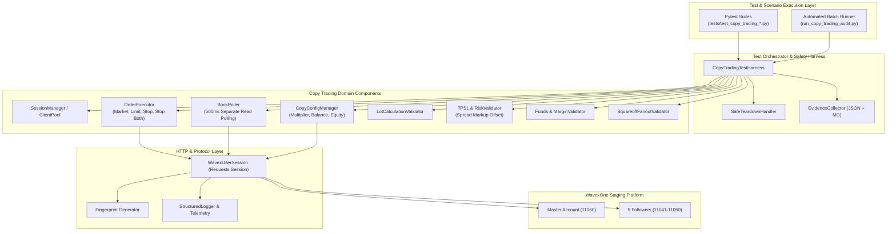

# WavexOne Copy Trading: Automation Framework Architecture

**Document Version:** 2.0.0  
**Target Platform:** WavexOne Staging (`https://stage.wavexone.com`)  
**Scope:** Reusable QA Automation Framework Architecture  
**Target Language/Tools:** Python 3.12, Pytest, Requests, Pydantic/Dataclasses

---

## 1. Architectural Overview & Component Hierarchy

The Copy Trading Automation Framework is structured into clean, decoupled, reusable layers designed to guarantee independent verification, zero credential leakage, strict teardown, and resilient fanout testing across 1 Master and 5 Follower accounts.



---

## 2. Detailed Component Specifications

### 2.1 Authentication & Session Management (`SessionManager`)
- **Responsibilities:**
  - Authenticate Master (`ctmaster@mailinator.com`) and all 5 Followers (`ctf1`–`ctf5`).
  - Read credentials exclusively from `.env`.
  - Validate live `account_id` from `/dashboard/api/accountList.php` against expected staging accounts (`11060`, `11041`, `11043`, `11045`, `11048`, `11050`).
  - Automatically handle session refresh on stale token or expiration.
- **Key Interface:**
  ```python
  class SessionManager:
      def authenticate_all(self) -> Dict[str, WavexUserSession]: ...
      def get_master(self) -> WavexUserSession: ...
      def get_followers(self) -> List[WavexUserSession]: ...
      def get_follower(self, name_or_acc: str) -> WavexUserSession: ...
  ```

---

### 2.2 Copy Configuration Component (`CopyConfigManager`)
- **Responsibilities:**
  - Manages `/user/follow.php` and `/user/updateCopyTradingMethod.php`.
  - Enforces atomic method switching across followers (`multiplier`, `balance`, `equity`).
  - Queries `/user/userCopyFollowers.php` to verify subscription status and configuration state.
- **Key Interface:**
  ```python
  class CopyConfigManager:
      def set_all_followers_mode(self, method: str, value: str = "") -> bool: ...
      def set_follower_mode(self, follower: WavexUserSession, method: str, value: str = "") -> bool: ...
      def verify_all_active(self, expected_method: str = "multiplier") -> Dict[str, bool]: ...
      def restore_baseline(self) -> bool: ...  # Multiplier 3.0x on all 5
  ```

---

### 2.3 Order Placement Component (`OrderExecutor`)
- **Responsibilities:**
  - Handles `/trade/placeorder.php` for all 4 order types: `market`, `limit`, `stop`, `stop both`.
  - Dynamic CMP discovery via `get_fresh_price()` before submitting price-dependent orders.
  - Automatically sets mandatory protocol parameters (e.g. `bs="buy"` for `stop_hft_type=2`).
  - Robust payload extraction defensively handling dictionary, list, or compound string order IDs.
- **Key Interface:**
  ```python
  class OrderExecutor:
      def place_market_order(self, session: WavexUserSession, symbol: str, side: str, lots: float, tp: str = "", sl: str = "") -> OrderResult: ...
      def place_limit_order(self, session: WavexUserSession, symbol: str, side: str, lots: float, price: float) -> OrderResult: ...
      def place_stop_order(self, session: WavexUserSession, symbol: str, side: str, lots: float, trigger_price: float) -> OrderResult: ...
      def place_stop_both(self, session: WavexUserSession, symbol: str, lots: float, buy_trigger: float, sell_trigger: float) -> DualOrderResult: ...
  ```

---

### 2.4 Separate Read Polling Component (`BookPoller`)
- **Responsibilities:**
  - **Critical Rule:** Never rely on HTTP 200 from `/trade/placeorder.php`.
  - Poll `/book/orders.php` every $500\text{ms}$ up to configurable timeout ($10\text{s}$).
  - Concurrently query Master and all 5 Followers using `ThreadPoolExecutor`.
  - Measure fanout latency per follower ($T_{\text{replicated}} - T_{\text{master}}$).
- **Key Interface:**
  ```python
  class BookPoller:
      def wait_for_follower_replication(self, followers: List[WavexUserSession], symbol: str, side: str, expected_lot: Optional[float] = None, timeout: float = 10.0) -> Dict[str, OrderSnapshot]: ...
      def wait_for_all_closed(self, accounts: List[WavexUserSession], timeout: float = 10.0) -> bool: ...
      def poll_order_book(self, session: WavexUserSession) -> List[Dict[str, Any]]: ...
  ```

---

### 2.5 Lot Calculation Validation Component (`LotCalculationValidator`)
- **Responsibilities:**
  - Calculates theoretical follower lot volume for all 3 copy sizing modes:
    - Multiplier: $\text{MasterLot} \times \text{Multiplier}$.
    - Balance: $\frac{\text{FollowerBal}}{\text{MasterBal}} \times \text{MasterLot}$.
    - Equity: $\frac{\text{FollowerEq}}{\text{MasterEq}} \times \text{MasterLot}$.
  - Applies broker standard rounding (2 decimal precision, step 0.01).
  - Asserts actual replicated volume against mathematical expectation within tolerance ($\pm 0.001$).
- **Key Interface:**
  ```python
  class LotCalculationValidator:
      def validate_multiplier_lot(self, master_lot: float, multiplier: float, actual_follower_lot: float) -> ValidationResult: ...
      def validate_balance_lot(self, master_lot: float, master_bal: float, follower_bal: float, actual_follower_lot: float) -> ValidationResult: ...
      def validate_equity_lot(self, master_lot: float, master_eq: float, follower_eq: float, actual_follower_lot: float) -> ValidationResult: ...
  ```

---

### 2.6 TP/SL and Risk Parameter Validation Component (`RiskParameterValidator`)
- **Responsibilities:**
  - Verifies Take Profit and Stop Loss values are faithfully propagated.
  - Accounts for broker spread markup on follower execution prices ($\Delta \approx +5.5\text{ pts}$ on `BTCUSD`).
  - Verifies follower stop levels remain safe from immediate execution.
- **Key Interface:**
  ```python
  class RiskParameterValidator:
      def validate_tpsl_propagation(self, master_order: Dict[str, Any], follower_orders: Dict[str, Dict[str, Any]]) -> ValidationResult: ...
      def check_spread_markup_safety(self, master_fill_price: float, follower_fill_price: float, sl_price: float) -> bool: ...
  ```

---

### 2.7 Funds, Margin & P&L Validation Component (`FundsMarginValidator`)
- **Responsibilities:**
  - Queries pre-trade and post-trade balances from `/book/balance.php`.
  - Verifies margin reservation upon position opening: $\text{Free Margin}_{\text{post}} = \text{Free Margin}_{\text{pre}} - \text{Used Margin}$.
  - Reconciles realized P&L upon position square-off: $\Delta\text{Balance} = \text{Realized P\&L} - \text{Commission}$.
- **Key Interface:**
  ```python
  class FundsMarginValidator:
      def capture_balance_snapshot(self, accounts: List[WavexUserSession]) -> Dict[str, BalanceSnapshot]: ...
      def verify_margin_reservation(self, pre_snap: BalanceSnapshot, post_snap: BalanceSnapshot, expected_lots: float) -> ValidationResult: ...
      def verify_pnl_reconciliation(self, pre_snap: BalanceSnapshot, post_snap: BalanceSnapshot, realized_pnl: float) -> ValidationResult: ...
  ```

---

### 2.8 Square-Off Fanout Validation Component (`SquareoffValidator`)
- **Responsibilities:**
  - Manages Master square-off via `/book/squareoff.php`.
  - Manages Follower independent square-off.
  - Concurrently polls all 5 follower order books to measure liquidation latency.
  - Asserts that all follower positions are liquidated cleanly within $3.0\text{ seconds}$.
- **Key Interface:**
  ```python
  class SquareoffValidator:
      def execute_master_squareoff(self, master: WavexUserSession, followers: List[WavexUserSession]) -> FanoutExitResult: ...
      def execute_follower_isolation_squareoff(self, target_follower: WavexUserSession, master: WavexUserSession, peers: List[WavexUserSession]) -> IsolationExitResult: ...
  ```

---

### 2.9 Execution Logging & Evidence Recording Component (`EvidenceRecorder`)
- **Responsibilities:**
  - Captures full request/response payloads, order IDs, latencies, and step results.
  - **Zero Credential Exposure:** Redacts tokens, passwords, and sensitive headers.
  - Exports dual evidence files per test case:
    - `reports/evidence/{test_id}.json` (Machine-readable full telemetry)
    - `reports/evidence/{test_id}.md` (Human-readable executive audit)
- **Key Interface:**
  ```python
  class EvidenceCollector:
      def log_step(self, step_name: str, action: str, endpoint: str, request_data: Any, response_data: Any, latency_ms: float): ...
      def log_assertion(self, name: str, expected: Any, actual: Any, passed: bool, notes: str = ""): ...
      def finish(self, status: str, error: str = None) -> Dict[str, Any]: ...
  ```

---

### 2.10 Safe Teardown & Residual Cleanup Handler (`SafeTeardownHandler`)
- **Responsibilities:**
  - **Multi-Tier Cleanup Guarantee:**
    1. Square off all active market positions across Master and 5 Followers.
    2. Explicitly cancel all residual pending limit and stop orders (including Stop BOTH orphaned legs [BUG-03]).
    3. Verify that `/book/orders.php` returns length 0 for all 6 accounts.
    4. Restore all 5 followers to baseline `method="multiplier"`, `value="3.0"`.
  - Execute automatically after every test case via Pytest fixture `yield` or `try...finally`.
- **Key Interface:**
  ```python
  class SafeTeardownHandler:
      def cleanup_all(self, master: WavexUserSession, followers: List[WavexUserSession]) -> CleanupReport: ...
      def purge_residual_pending_orders(self, accounts: List[WavexUserSession]) -> int: ...
      def assert_clean_slate(self, accounts: List[WavexUserSession]) -> bool: ...
  ```

---

## 3. Data Contracts & Models

```python
from dataclasses import dataclass
from typing import Optional, List, Dict, Any

@dataclass
class OrderResult:
    order_id: str
    status: str
    symbol: str
    side: str
    lots: float
    price: float
    latency_ms: float
    raw_response: Dict[str, Any]

@dataclass
class DualOrderResult:
    buy_order_id: str
    sell_order_id: str
    status: str
    latency_ms: float

@dataclass
class BalanceSnapshot:
    account_id: str
    balance: float
    equity: float
    margin: float
    free_margin: float
    timestamp: float

@dataclass
class ValidationResult:
    passed: bool
    expected: Any
    actual: Any
    discrepancy: str = ""
```

