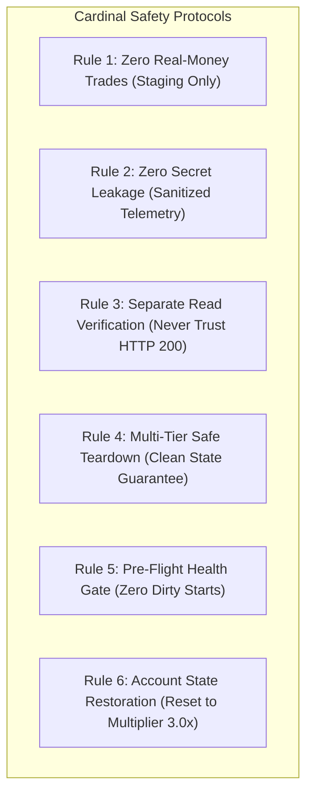
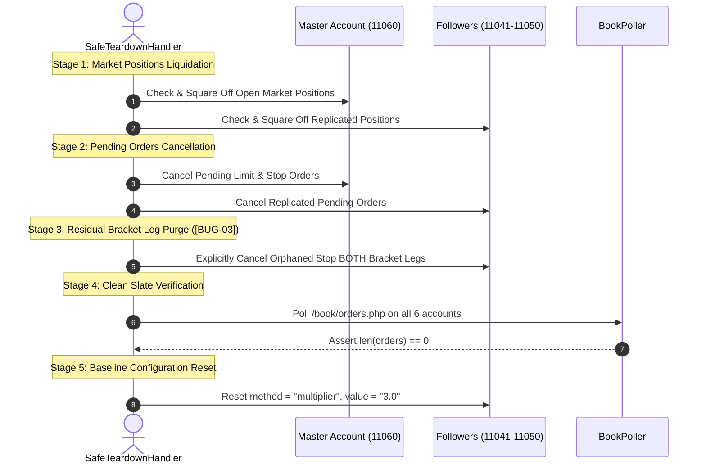

# WavexOne Copy Trading: Automation Safety Rules & Quality Protocols

**Document Version:** 2.0.0  
**Target Platform:** WavexOne Staging (`https://stage.wavexone.com`)  
**Scope:** Safety Constraints, Clean Teardown, and Credential Governance  
**Audience:** QA Engineers, System Architects, Automation Developers

---

## 1. Cardinal Safety Principles

Automation interacting with financial trading engines requires rigid safeguards to ensure platform integrity, prevent account lockouts, avoid credential leakage, and eliminate residual orphan positions.

---

## 2. Rule 1: Zero Real-Money Trades (Staging Only)
1. **Target Environment Strictness:** All tests must strictly target `https://stage.wavexone.com`. Execution against production URLs (`https://wavexone.com` or `https://app.wavexone.com`) is strictly prohibited.
2. **Approved Test Account Boundary:** Execution is strictly restricted to the six approved staging accounts:
   - Master Account ID: `11060` (UID: `1060`)
   - Follower Accounts: `11041`, `11043`, `11045`, `11048`, `11050`
   - Target Instrument: `X:BTCUSD`
3. **Execution Guard:** The framework must validate the loaded `BASE_URL` and `account_id` at session startup. If an unexpected account ID or production domain is detected, the framework will throw an immediate fatal error and terminate.

---

## 3. Rule 2: Zero Secret Exposure & Sanitized Logging
1. **Credential Source:** Credentials, tokens, and keys must be read strictly from environment variables or local `.env`. Hardcoded passwords or tokens are strictly prohibited.
2. **Telemetry Sanitization:** The `EvidenceCollector` and `StructuredLogger` must sanitize all payloads before writing to disk or stdout:
   - Passwords must be redacted (`[REDACTED]`).
   - Session tokens must be masked (`tok_****` or omitted).
   - Execution fingerprints and auth cookies must be stripped from evidence files.
3. **Evidence Integrity:** Evidence files (`reports/evidence/*.json` and `*.md`) must be fully shareable with external auditors without exposing account security credentials.

---

## 4. Rule 3: Strict Separate Read Verification (Never Rely on HTTP 200)
1. **The HTTP 200 Anti-Pattern:** A response of `{"status": "success"}` or `HTTP 200 OK` from `/trade/placeorder.php` only indicates that the gateway accepted the message. It **does NOT prove** that:
   - The matching engine filled the order.
   - The queue worker fanned out the order to followers.
   - The follower possessed sufficient margin.
   - The follower order executed at the correct price and lot volume.
2. **Mandatory Protocol:** Every placement, square-off, cancellation, or modification must be independently verified by separate polling of `/book/orders.php` and `/book/balance.php` on **both Master and all 5 Followers**.

---

## 5. Rule 4: Multi-Tier Safe Teardown Protocol

Every test scenario must execute a deterministic 5-stage teardown sequence within a `finally` block or Pytest fixture post-yield:

### Critical Rules for Teardown:
- **Never Silently Ignore Failed Cleanup:** If teardown fails to liquidate an open order within $10\text{s}$, the framework must emit a critical alert and halt subsequent tests to prevent margin cascades.
- **Stop BOTH Bracket Cleanup ([BUG-03]):** The teardown handler must specifically inspect and cancel opposite pending legs left over by Stop BOTH executions.

---

## 6. Rule 5: Pre-Flight Health Gate (Zero Dirty Starts)
Before any test scenario executes its first step:
1. The harness checks `/book/orders.php` across Master and all 5 Followers.
2. **If any account has an open or pending order:** The harness flags a `DIRTY_STATE_DETECTED` warning, immediately invokes the emergency teardown handler, and waits until all books reach length 0.
3. If the dirty state cannot be cleared, the test is marked `BLOCKED` to prevent invalid test results.

---

## 7. Rule 6: Account State & Configuration Restoration
1. When a test alters account settings (e.g., switching follower copy mode to `balance` or `equity`, or changing multipliers):
2. The teardown handler must restore all 5 followers back to the agreed baseline:
   - `method = "multiplier"`
   - `value = "3.0"`
3. This ensures subsequent test cases execute from an identical, predictable starting baseline.

---

## 8. Rule 7: Spread Markup Safety Buffer
1. Empirical testing proves follower orders on `X:BTCUSD` fill with a broker spread markup of $\approx +5.4\text{ to }+5.6$ points relative to Master.
2. **Safety Rule:** Any Master order that sets Stop Loss or Take Profit must maintain a minimum distance buffer of $\mathbf{\ge 8.0\text{ to }10.0\text{ points}}$ from CMP.
3. Placing tight stops ($< 5.0$ points) will cause followers to immediately trigger Stop Loss upon replication, invalidating copy trading test assertions.

---

## 9. Rule 8: Distinguishing Platform Defects from Framework Defects

To maintain credibility and clarity, test results and failure logs must strictly distinguish between:

| Issue Type | Definition | Example | Framework Action |
|---|---|---|---|
| **Framework Defect** | Bug in test harness, selector, parsing, or network client | `AttributeError: 'list' object has no attribute 'get'` | Fix test script logic |
| **Platform Defect** | Server-side bug where broker violates business rules | Stop BOTH leaves residual pending leg ([BUG-03]) | Record as `FAIL` with defect tag `[PLATFORM_BUG]` |
| **Architectural Gap** | Documented limitation of staging environment | Endpoint `/user/auto_squareoff.php` returns 404 ([ARCH-01]) | Record as `INCONCLUSIVE` with tag `[ARCH_LIMITATION]` |
| **Platform Outage** | Staging server down or network failure | HTTP 504 Gateway Timeout on login | Record as `BLOCKED` |

