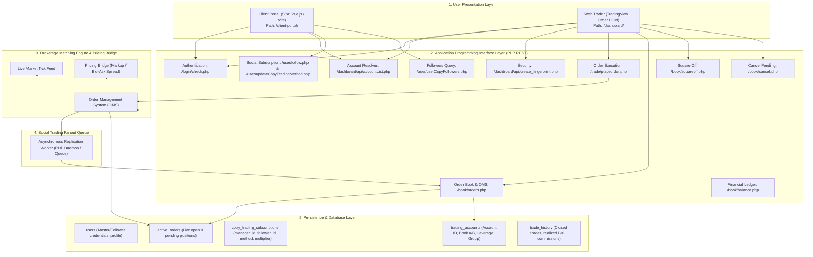
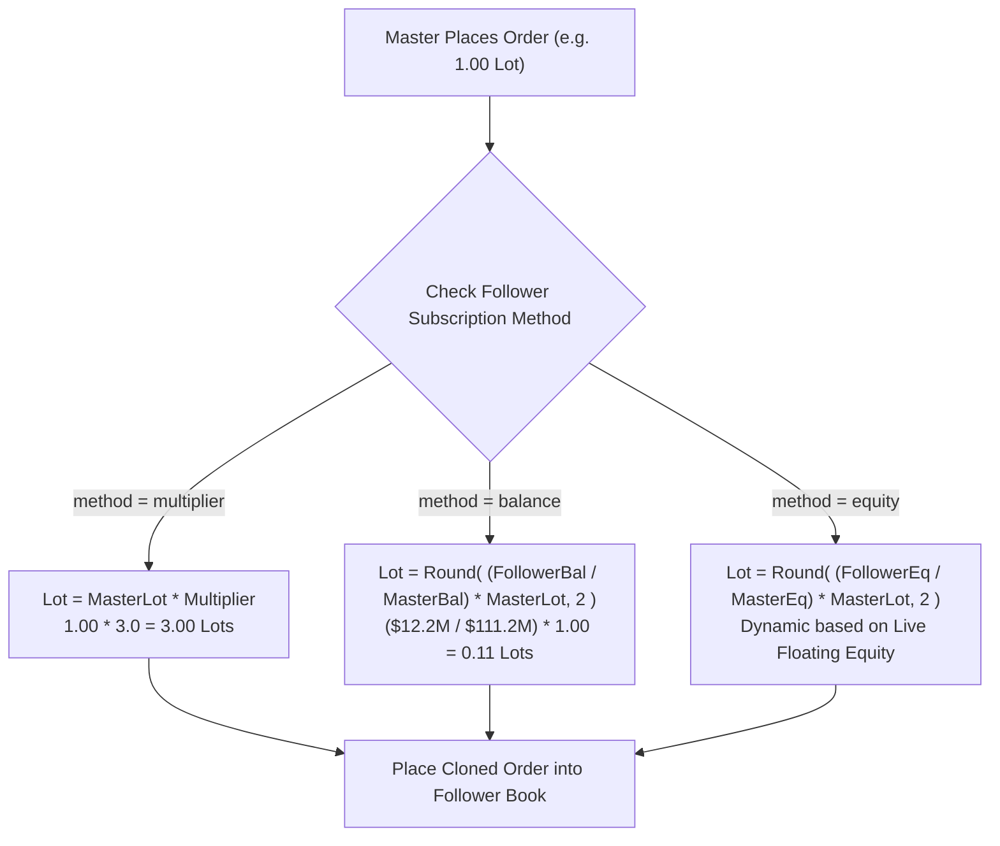

# WavexOne Copy Trading: Complete System Knowledge & Architectural Guide

**Document Version:** 1.0.0  
**Target Environment:** WavexOne Staging (`https://stage.wavexone.com`)  
**Scope:** Copy Trading Engine Architecture & Account Relationships (Excludes MAM & PAMM)  
**Author:** Senior QA Automation Architect (Financial Trading & Brokerage Platforms)

---

## 1. System Overview & Platform Architecture

WavexOne is an institutional-grade CFD and Forex social trading brokerage platform. It provides copy trading functionality where trades placed by a designated **Master Trader** are replicated automatically to subscribed **Follower Accounts** according to mathematical scaling algorithms.

### 1.1 Architectural Layers

---

## 2. Master and Follower Account Relationships

### 2.1 Approved Test Accounts Hierarchy
On the WavexOne Staging platform, the copy trading architecture is bounded by the following approved accounts:

| Role | Account Username | User ID (UID) | Trading Account ID | Account Group / Leverage | Staging Balance | Initial Copy Configuration |
| :--- | :--- | :--- | :--- | :--- | :--- | :--- |
| **Master** | `ctmaster` | `1060` | `11060` | Standard / 1:500 | ~$111,221,862.00 | Manager / Provider UID: `1060` |
| **Follower 1** | `ctf1` | `1041` | `11041` | Standard / 1:500 | ~$12,233,121.00 | Multiplier 3.0x |
| **Follower 2** | `ctf2` | `1043` | `11043` | Standard / 1:500 | ~$12,206,048.00 | Multiplier 3.0x |
| **Follower 3** | `ctf3` | `1045` | `11045` | Standard / 1:500 | ~$12,106,266.00 | Multiplier 3.0x |
| **Follower 4** | `ctf4` | `1048` | `11048` | Standard / 1:500 | ~$12,107,219.00 | Multiplier 3.0x |
| **Follower 5** | `ctf5` | `1050` | `11050` | Standard / 1:500 | ~$12,107,020.00 | Multiplier 3.0x |

### 2.2 Account Linkage & Database Schema Mapping
A follower is linked to a master via a unique subscription entity:
- **`manager_id` (`1060`):** The Master's primary UID.
- **`account_id` (`11060`):** The Master's trading account number.
- **`uid` (e.g. `3355549`):** Unique auto-increment subscription identifier.
- **`trade_method`:** Sizing algorithm (`multiplier`, `balance`, or `equity`).
- **`multiplier_value`:** Scaling coefficient (e.g., `3.0`, active only when `trade_method == "multiplier"`).

---

## 3. The Follow and Unfollow Lifecycle

### 3.1 Follow Workflow
1. Follower navigates to Client Portal Social Trading manager directory.
2. Selects Master UID `1060`.
3. Selects Trade Method (`multiplier`, `balance`, or `equity`) and specifies Multiplier Value if applicable.
4. Client Portal calls `POST /user/follow.php` with `{follow: 1060, type: "follow", method: "...", value: "..."}`.
5. Database creates row in `copy_trading_subscriptions`.
6. Subsequent Master orders trigger replication.

### 3.2 Unfollow Workflow
1. Follower initiates unfollow via Client Portal.
2. Calls `POST /user/follow.php` with `{follow: 1060, type: "unfollow"}`.
3. Subscription status is set to inactive or deleted from database.
4. Subsequent Master orders are no longer replicated to this follower.

---

## 4. The Three Copy Sizing Algorithms

WavexOne implements three mathematical models for sizing copied trades:

---

## 5. Order Types & Execution Lifecycle

### 5.1 Market Orders
- **Master Placement:** `type=market`, `bs=buy|sell`, `lot=1.00`.
- **Replication:** Instantly cloned as market positions with identical sides and calculated lot sizes.
- **Execution Timing:** 1.0s to 2.2s across all 5 followers on Staging.

### 5.2 Limit Orders
- **Master Placement:** `type=limit`, `trigger={price}`.
- **Replication:** Follower replicates a **Pending Limit Order** at the identical trigger price.
- **Fill Behavior:** When market price ticks past the trigger, Master and Follower orders fill into active market positions simultaneously.

### 5.3 Stop HFT Orders
- **Master Placement:**
  - `type=stop`, `stop_hft_type=1`: Stop BUY (trigger above CMP).
  - `type=stop`, `stop_hft_type=0`: Stop SELL (trigger below CMP).
  - `type=stop`, `stop_hft_type=2`: Stop BOTH (dual breakout brackets above ask and below bid).
- **Backend Protocol Requirement:** When placing Stop BOTH (`stop_hft_type=2`), the parameter `bs` **must strictly be set to `buy`**. The backend automatically parses this to create dual linked legs returning `orderId: "58777,58778"`.

---

## 6. Exit Mechanisms & Auto Square-Off

Positions exit through one of the following mechanisms:

1. **Take Profit (TP Hit):** Continuously evaluated by matching engine on live ticks. When CMP crosses TP, Master auto-closes and followers auto-close.
2. **Stop Loss (SL Hit):** Continuously evaluated. When CMP crosses SL, engine executes auto square-off within ~1.5s–2.5s.
3. **Master Manual Square-Off Fanout:** Master calls `GET /book/squareoff.php?id={master_order_id}`. Server asynchronously fans out squareoff to all followers in ~1.20s.
4. **Partial Square-Off:** Master calls `/book/squareoff.php?close_mode=partial&partial_lot=0.50`. Follower lots reduce proportionally (3.00 -> 1.50).
5. **Pending Cancellation:** Master cancels via `/book/cancel.php`. Cloned follower pending orders are cancelled automatically.
6. **Follower Early Close:** Follower manually calls `/book/squareoff.php` on their own cloned position. Closes only that follower; Master and peers remain unaffected.

