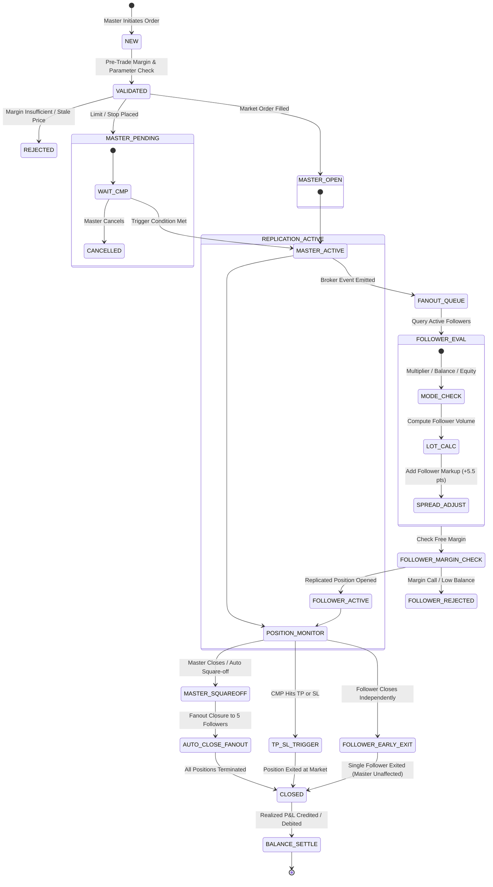
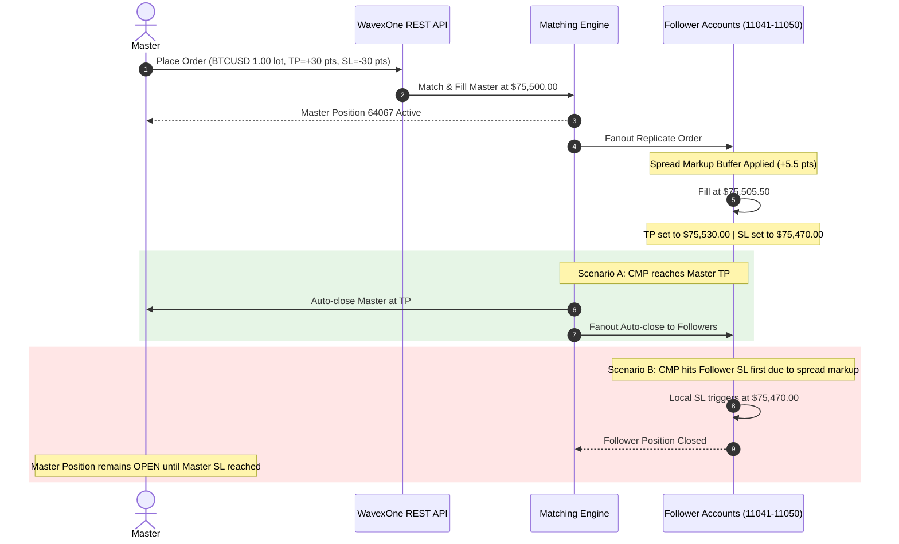

# WavexOne Copy Trading: Complete Order Lifecycle Architecture

**Document Version:** 1.0.0  
**Target Platform:** WavexOne Staging (`https://stage.wavexone.com`)  
**Scope:** Copy Trading Engine Lifecycle & State Synchronization  
**Target Accounts:** Master (`11060` / UID `1060`), Followers (`11041`, `11043`, `11045`, `11048`, `11050`)

---

## 1. End-to-End Order State Machine

The WavexOne Copy Trading engine operates as an asynchronous fanout pipeline driven by Master account actions. Every Master trade transitions through a deterministic sequence of broker states that propagate to downstream follower accounts.

---

## 2. Order Lifecycle by Order Type

### 2.1 Market Orders (`type=market`)

1. **Submission (`/trade/placeorder.php`):**
   - Master sends `account_id=11060`, `type=market`, `bs=buy|sell`, `lots=1.00`, `symbol=X:BTCUSD`.
   - Master receives synchronous fill with `orderId` (e.g., `64067`).
2. **Replication Trigger:**
   - Database trigger or internal queue worker detects new filled position where account is marked as Copy Master (`1060`).
   - Query table `user_copy_followers` for active subscriptions (`is_active=1`, `status=active`).
3. **Follower Order Generation:**
   - Evaluates each follower's sizing method (`multiplier`, `balance`, `equity`).
   - Generates follower orders (`lots` adjusted, fill price stamped with markup buffer $\approx \pm 5.5\text{ pts}$).
   - Follower orders execute within SLA of $1.0\text{s} - 2.2\text{s}$.
4. **Active State:**
   - Position appears in `/book/orders.php` for Master and each of the 5 followers.
5. **Termination:**
   - Master squareoff `/book/squareoff.php` triggers fanout closure across all 5 followers within $1.5\text{s} - 3.0\text{s}$.

---

### 2.2 Limit Orders (`type=limit`)

1. **Submission:**
   - Master sends `type=limit`, `price=<entry_price>` (e.g., Buy Limit below CMP, Sell Limit above CMP).
   - Order registered as `pending` on Master.
2. **Replication Strategy:**
   - Follower accounts receive replicated pending limit orders with matching price boundaries or proportional price offsets.
3. **Execution Trigger:**
   - When market price crosses the limit threshold, Master order transitions from `pending` to `open` (market fill).
   - Follower pending orders transition to `open` with follower execution prices.
4. **Cancellation Propagation:**
   - If Master cancels the limit order via `/book/cancel.php`, cancellation fans out to all follower pending orders.

---

### 2.3 Stop Orders (`type=stop`)

1. **Submission:**
   - Master sends `type=stop`, `price=<trigger_price>` (e.g., Buy Stop above CMP, Sell Stop below CMP).
   - Stored in broker book as conditional entry order.
2. **Execution Trigger:**
   - Market reaches or breaches `trigger_price`.
   - Order converts to market order at prevailing price.
   - Replicated follower positions fill accordingly.

---

### 2.4 Stop HFT BOTH Orders (`type=stop`, `stop_hft_type=2`)

1. **Submission Requirements:**
   - Parameter `bs` **MUST** be explicitly set to `"buy"` (`/trade/placeorder.php` rejects `"sell"` or `"both"` with validation error).
   - `stop_hft_type=2` indicates a dual bracket breakout strategy.
   - Returns compound order ID string: `"orderId": "58777,58778"`.
2. **Bracket Generation:**
   - Leg A: Buy Stop placed at $\text{CMP} + \text{offset}$.
   - Leg B: Sell Stop placed at $\text{CMP} - \text{offset}$.
3. **Execution & Auto-Close Behavior:**
   - When market rallies, Buy Stop triggers and fills.
   - **Critical Bug Identified ([BUG-03]):** The matching engine fills the active leg and auto-closes it upon target, but **leaves the residual opposite pending leg open** on the follower account. Automated teardown must explicitly poll and cancel residual pending brackets.

---

## 3. Position Sizing Lifecycle in the 3 Modes

| Stage | Multiplier Mode | Balance-Based Mode | Equity-Based Mode |
|---|---|---|---|
| **1. Configuration** | `method: "multiplier"`, `value: "3.0"` | `method: "balance"`, `value: "1.0"` | `method: "equity"`, `value: "1.0"` |
| **2. Dynamic Probe** | Static setting | Fetches Follower Balance & Master Balance | Fetches Follower Equity & Master Equity |
| **3. Calculation Formula** | $\text{FollowerLot} = \text{MasterLot} \times 3.0$ | $\text{FollowerLot} = \frac{\text{FollowerBal}}{\text{MasterBal}} \times \text{MasterLot}$ | $\text{FollowerLot} = \frac{\text{FollowerEq}}{\text{MasterEq}} \times \text{MasterLot}$ |
| **4. Live Values Verified** | $1.00 \times 3.0 = \mathbf{3.00\text{ lots}}$ | $\frac{\$12.23\text{M}}{\$111.22\text{M}} \times 1.00 = \mathbf{0.11\text{ lots}}$ | $\frac{\$12.23\text{M}}{\$111.22\text{M}} \times 1.00 = \mathbf{0.11\text{ lots}}$ |
| **5. Rounding Rule** | Standard broker lot precision (2 decimals) | Rounded to broker step size (0.01) | Rounded to broker step size (0.01) |
| **6. Execution** | 5 followers place 3.00 lots | 5 followers place 0.11 lots | 5 followers place 0.11 lots |

---

## 4. Take Profit (TP) and Stop Loss (SL) Lifecycle

### Critical Sizing & Distance Constraints:
1. **Spread Markup Offset ($\Delta \approx 5.5\text{ pts}$):**
   - Follower buy positions fill at Master Price $+ 5.5$ pts.
   - If Master sets SL at only $3.0$ pts below entry, follower SL is effectively breached immediately or placed inside the spread.
   - **Architectural Rule:** TP/SL offsets on Master must be $\ge 8.0$ to $10.0$ points to guarantee stable replication.

---

## 5. Square-Off & Exit Lifecycle

### 5.1 Master Square-Off (Global Exit)
- Master calls `/book/squareoff.php` with `order_id` or `all=true`.
- Matching engine closes Master position.
- Fanout worker iterates through all linked follower positions and submits market close orders.
- Replication latency: all 5 followers closed within $2.15\text{ seconds}$ on Staging.

### 5.2 Follower Independent Square-Off (Peer Isolation)
- An individual follower calls `/book/squareoff.php` on their own replicated order.
- Engine closes the follower's position.
- **Master account is unaffected** and continues running.
- **The other 4 followers are unaffected** and continue running.

---

## 6. Realized Settlement and Balance Lifecycle
1. When position status transitions to `closed`, realized P&L is calculated:
   $$\text{Realized P\&L} = (\text{Close Price} - \text{Open Price}) \times \text{Lots} \times \text{Contract Size} - \text{Commission}$$
2. Account `balance` is updated synchronously via broker ledger.
3. Account `free_margin` is released.
4. Next balance-based or equity-based replication uses the updated ledger balance.

