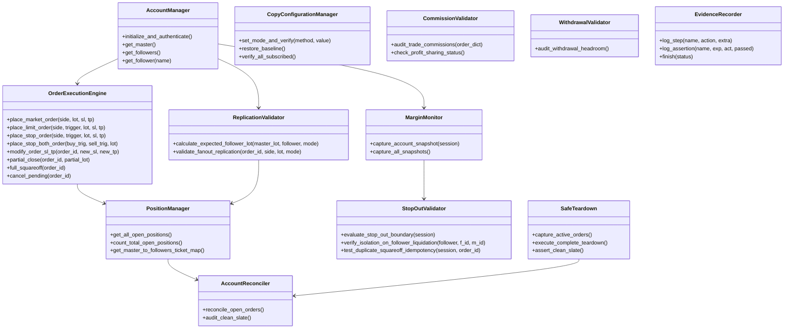

# WavexOne Unified Copy Trading QA Architecture Specification

**Architecture Version:** 1.0.0  
**Effective Date:** 2026-11-06  
**Implementation Package:** [`core/copy_trading/`](file:///c:/testing%20wavexone/core/copy_trading/)  

---

## 1. Architectural Philosophy

The WavexOne Unified QA Framework consolidates disparate, overlapping test scripts into a modular, enterprise-grade test automation architecture. It eliminates duplicate scenarios, unifies fragmented polling routines, replaces shallow assertions with mathematical proofs, and guarantees deterministic account teardown.

---

## 2. Component Hierarchy & Layered Design

---

## 3. The 12 Reusable Unified Components

| Component | Class Name | File Location | Responsibility |
| :--- | :--- | :--- | :--- |
| **1. Account Manager** | `AccountManager` | [`core/copy_trading/unified_components.py`](file:///c:/testing%20wavexone/core/copy_trading/unified_components.py) | Authenticates Master and 5 Followers; enforces staging safety boundaries. |
| **2. Configuration Manager** | `CopyConfigurationManager` | [`core/copy_trading/unified_components.py`](file:///c:/testing%20wavexone/core/copy_trading/unified_components.py) | Configures replication mode (Multiplier, Balance, Equity) and validates subscriptions. |
| **3. Order Execution Engine** | `OrderExecutionEngine` | [`core/copy_trading/unified_components.py`](file:///c:/testing%20wavexone/core/copy_trading/unified_components.py) | High-level interface to fire Market, Limit, Stop HFT, modification, and partial exits. |
| **4. Replication Validator** | `ReplicationValidator` | [`core/copy_trading/unified_components.py`](file:///c:/testing%20wavexone/core/copy_trading/unified_components.py) | Validates sizing formulas, latencies, side, TP/SL, and child tickets across all 5 followers. |
| **5. Position Manager** | `PositionManager` | [`core/copy_trading/unified_components.py`](file:///c:/testing%20wavexone/core/copy_trading/unified_components.py) | Maps parent-to-child ticket hierarchies, tracks state transitions, and exposure. |
| **6. Margin Monitor** | `MarginMonitor` | [`core/copy_trading/unified_components.py`](file:///c:/testing%20wavexone/core/copy_trading/unified_components.py) | Captures real Equity, Used Margin, Free Margin, and Margin Level % snapshots. |
| **7. Stop-Out Validator** | `StopOutValidator` | [`core/copy_trading/unified_components.py`](file:///c:/testing%20wavexone/core/copy_trading/unified_components.py) | Tests 50% Stop-out boundary conditions, follower isolation, and OMS idempotency. |
| **8. Commission Validator** | `CommissionValidator` | [`core/copy_trading/unified_components.py`](file:///c:/testing%20wavexone/core/copy_trading/unified_components.py) | Audits commissions, overnight swaps, and checks profit-sharing platform flags. |
| **9. Withdrawal Validator** | `WithdrawalValidator` | [`core/copy_trading/unified_components.py`](file:///c:/testing%20wavexone/core/copy_trading/unified_components.py) | Audits withdrawal safeguards, open order locks, and margin reserve headroom. |
| **10. Account Reconciler** | `AccountReconciler` | [`core/copy_trading/unified_components.py`](file:///c:/testing%20wavexone/core/copy_trading/unified_components.py) | Cross-audits open books, flags orphaned child orders, and verifies clean slate. |
| **11. Evidence Recorder** | `EvidenceRecorder` | [`core/copy_trading/evidence_recorder.py`](file:///c:/testing%20wavexone/core/copy_trading/evidence_recorder.py) | Scrubs credentials and logs step-by-step requests, responses, latencies, and diffs. |
| **12. Safe Teardown** | `SafeTeardown` | [`core/copy_trading/safe_teardown.py`](file:///c:/testing%20wavexone/core/copy_trading/safe_teardown.py) | Liquidates open positions, purges pending orders, and restores baseline Multiplier 3.0x. |

---

## 4. Key Improvements Over Legacy Tests

1. **Elimination of Shallow Assertions:**
   - *Legacy:* Asserted `res['status'] == 'success'` without verifying follower order books.
   - *Unified:* Asserts child ticket creation, exact calculated lot size, side matching, and latency $< 3.0\text{s}$.
2. **Dynamic Mathematical Ratio Sizing:**
   - Computes expected lot size using live account balances/equities rather than hardcoded floats.
3. **Robust Teardown Guarantee:**
   - All tests enforce pre-test and post-test clean slate audits (0 open orders, 0 pending orders, Used Margin = \$0.00).
