# WavexOne Unified Copy Trading End-to-End Business Flow

**Document Version:** 1.0.0  
**Effective Date:** 2026-11-06  
**Target Platform:** `https://stage.wavexone.com`  
**Classification:** Enterprise Trading Systems QA Specification  

---

## 1. Overview

This document defines the canonical 20-stage business flow governing the **WavexOne Social Copy Trading Platform**. It synthesizes all individual execution phases (P0 preflight, UI workflows, full order matrix, in-flight lifecycle, and margin risk management) into a single, cohesive, end-to-end trading systems specification.

---

## 2. The 20-Stage End-to-End Copy Trading Lifecycle

```mermaid
flowchart TD
    subgraph S1_Setup ["Stages 1-3: Setup & Authentication"]
        A1["1. Environment & Account Validation"] --> A2["2. Master & Follower Account Mgmt"]
        A2 --> A3["3. Copy Subscription & Configuration"]
    end

    subgraph S2_Modes ["Stages 4-6: Sizing Modes"]
        A3 --> B1["4. Multiplier Allocation (3.0x)"]
        B1 --> B2["5. Balance-Based Allocation"]
        B2 --> B3["6. Equity-Based Allocation"]
    end

    subgraph S3_Replication ["Stages 7-10: Order Replication"]
        B3 --> C1["7. Market Order Replication"]
        C1 --> C2["8. Limit Order Replication"]
        C2 --> C3["9. Stop HFT Replication"]
        C3 --> C4["10. BUY, SELL & BOTH Dual-Leg"]
    end

    subgraph S4_InFlight ["Stages 11-13: In-Flight Lifecycle"]
        C4 --> D1["11. TP/SL Creation & Modification"]
        D1 --> D2["12. Partial Position Closure"]
        D2 --> D3["13. Concurrency & Burst Replication"]
    end

    subgraph S5_Risk ["Stages 14-17: Risk, Isolation & Liquidation"]
        D3 --> E1["14. Master/Follower Tenant Isolation"]
        E1 --> E2["15. Unfollow & Re-Follow Lifecycle"]
        E2 --> E3["16. Margin Monitoring & 50% Stop-Out"]
        E3 --> E4["17. Automatic Square-Off (SL/TP Hit)"]
    end

    subgraph S6_Settlement ["Stages 18-20: Settlement & Reconciliation"]
        E4 --> F1["18. Profit-Sharing & Performance Fees"]
        F1 --> F2["19. Withdrawal & Margin Lock"]
        F2 --> F3["20. Account Reconciliation & Cleanup"]
    end
```

---

### Stage 1: Environment and Account Validation
- **Objective:** Ensure all connections target the sanctioned staging domain (`stage.wavexone.com`).
- **Validation Rules:**
  - Prevent accidental test execution against production.
  - Assert that all 6 test accounts belong to the predefined staging roster:
    - Master Trader: `ctmaster` (UID `1060`, Trading Account `11060`)
    - Followers: `ctf1` (`11041`), `ctf2` (`11043`), `ctf3` (`11045`), `ctf4` (`11048`), `ctf5` (`11050`)
  - Authenticate all accounts using secure staging credentials.

### Stage 2: Master and Follower Account Management
- **Objective:** Verify account readiness, balances, leverage, and currency.
- **Validation Rules:**
  - Leverage confirmed at `1:500`.
  - Account currency confirmed as `USD`.
  - Non-zero balance and equity across all accounts.
  - Zero initial lingering orders before entering execution cycles.

### Stage 3: Copy Subscription and Configuration
- **Objective:** Verify that all 5 follower accounts maintain active subscription relationships with Master Trader `1060`.
- **Validation Rules:**
  - Query `/social/getFollowers.php` and `/social/getFollowing.php`.
  - Verify subscription active flag = `true`.

### Stage 4: Multiplier Allocation Mode
- **Objective:** Validate fixed-ratio proportional replication.
- **Mathematical Formula:**
  $$\text{Follower Lot} = \text{Master Lot} \times \text{Multiplier}$$
- **Verification Rule:**
  - Master opens 0.50 lot BTCUSD with Multiplier `3.0x`.
  - Followers must receive exactly $\mathbf{1.50\text{ Lots}}$ ($0.50 \times 3.0$).
  - Allowable tolerance: $\pm 0.00$ lots.

### Stage 5: Balance-Based Allocation Mode
- **Objective:** Validate dynamic lot sizing proportional to account cash balances.
- **Mathematical Formula:**
  $$\text{Follower Lot} = \text{round}\left( \text{Master Lot} \times \frac{\text{Follower Balance}}{\text{Master Balance}}, 2 \right)$$
- **Verification Rule:**
  - Master Balance $\approx \$111.2\text{M}$, Follower Balance $\approx \$12.17\text{M}$ (Ratio $\approx 0.109$).
  - Master opens 0.50 lot $\implies$ Follower receives $\text{round}(0.50 \times 0.109, 2) = \mathbf{0.05\text{ Lots}}$.

### Stage 6: Equity-Based Allocation Mode
- **Objective:** Validate dynamic lot sizing proportional to live account equity.
- **Mathematical Formula:**
  $$\text{Follower Lot} = \text{round}\left( \text{Master Lot} \times \frac{\text{Follower Equity}}{\text{Master Equity}}, 2 \right)$$
- **Verification Rule:**
  - With zero open positions, Equity = Balance.
  - Master opens 0.50 lot $\implies$ Follower receives $\text{round}(0.50 \times 0.109, 2) = \mathbf{0.05\text{ Lots}}$.

### Stage 7: Market Order Replication
- **Objective:** Immediate market entry replication across Master and all Followers.
- **Validation Rules:**
  - Master executes `/trade/placeorder.php?type=market`.
  - Child tickets created across all 5 followers within $< 3.0$ seconds.
  - Execution price reflects prevailing live market spread.

### Stage 8: Limit Order Replication
- **Objective:** Pending order book synchronization for price-level entries.
- **Validation Rules:**
  - Master places BUY LIMIT below market price or SELL LIMIT above market price.
  - Pending orders mirror to follower order books with matching trigger prices.
  - No margin used until filled.

### Stage 9: Stop Order Replication
- **Objective:** Pending Stop HFT order book synchronization.
- **Validation Rules:**
  - BUY STOP (`stop_hft_type=1`) placed above market price.
  - SELL STOP (`stop_hft_type=0`) placed below market price.
  - Pending orders mirror to followers with matching stop triggers.

### Stage 10: BUY, SELL and BOTH Directions
- **Objective:** Full directional coverage including dual-leg hedging.
- **Validation Rules:**
  - Long side (`BUY`), Short side (`SELL`), and Straddle Dual-Leg (`BOTH`).
  - Dual-leg places simultaneous BUY STOP and SELL STOP tickets cleanly.

### Stage 11: TP/SL Creation and Modification
- **Objective:** In-flight trade parameter management without ticket cancellation.
- **Validation Rules:**
  - Master modifies Stop Loss (`name=StopLoss`) or Take Profit (`name=Target`) via `/book/modify.php`.
  - All 5 follower tickets update in real-time to the new price levels.
  - Original ticket ID and volume remain unchanged.

### Stage 12: Partial Position Closure
- **Objective:** Proportional partial volume reduction fanout.
- **Validation Rules:**
  - Master closes partial volume (e.g. 0.20 lots out of 0.50, leaving 0.30 lots).
  - Multiplier mode followers reduce from 1.50 to 0.90 lots ($0.30 \times 3.0$).
  - Remaining open positions stay active without premature termination.

### Stage 13: Multiple-Order and Concurrent Replication
- **Objective:** Fanout queue depth and race-condition immunity under stress.
- **Validation Rules:**
  - Master fires 4 rapid-fire orders within $< 2$ seconds.
  - Engine queues and executes all 20 child tickets (4 per follower).
  - No dropped orders, deadlock exceptions, or duplicate order IDs.

### Stage 14: Master/Follower Tenant Isolation
- **Objective:** Strict boundary protection across trading accounts.
- **Validation Rules:**
  - Follower manual early exit closes child position **without touching Master or peers**.
  - Follower independent trade placement does **not** copy to Master or peers.

### Stage 15: Unfollow and Re-Follow Lifecycle
- **Objective:** Dynamic subscription management.
- **Validation Rules:**
  - Follower invokes `/social/unfollowMaster.php`. New Master trades stop copying to that follower.
  - Follower invokes `/social/followMaster.php`. Replication resumes seamlessly.

### Stage 16: Margin Monitoring and 50% Stop-Out
- **Objective:** Risk monitoring and mandatory broker stop-out liquidation.
- **Validation Rules:**
  - Real-time Margin Level monitoring: $\text{Margin Level} = (\text{Equity} / \text{Used Margin}) \times 100$.
  - At $\text{Margin Level} > 50\%$ (e.g. 60%), positions remain open (Safe from stop-out).
  - At $\text{Margin Level} \le 50.00\%$, automatic squareoff is triggered by the broker matching engine.
  - Staging Constraint: Artificial $111M balance requires $111.21M loss to trigger; marked BLOCKED if organic induction is infeasible without DB tampering.

### Stage 17: Automatic Square-Off (TP/SL Hit)
- **Objective:** Matching engine auto-exit when price touches Stop Loss or Take Profit.
- **Validation Rules:**
  - When market tick touches Master SL or TP, position closes automatically.
  - Replication worker detects closure and squares off all follower child tickets.

### Stage 18: Profit Sharing and Settlement Lifecycle
- **Objective:** Validates the automated Profit-Sharing Settlement engine and cross-account financial ledger.
- **Validation Rules:**
  - WavexOne Copy Trading operates strictly on a **Profit Sharing** model (configured at 10% per follower subscription). It does **NOT** charge performance fees or commissions.
  - **Profit Basis:** Calculated strictly from realized positive gross profit on closed trade tickets: $\text{Master Profit Share} = \text{Realized Profit} \times 10\%$.
  - **Partial Position Close:** Profit-Sharing Settlement occurs immediately upon full position closure or partial position closure for the closed volume portion.
  - **Losing Trades:** Zero profit sharing is assessed on negative PnL trades ($\text{Share} = \$0.00$). Losses do not offset previous or future profits (no High-Water Mark loss offset).
  - **Ledger Settlement:** Realized Master Profit Share is credited directly to the Master's account balance ($\text{Deposit} + \text{PnL} - \text{Swap} + \text{Master Profit Share}$), and recorded in the Follower's Profit-Sharing Settlement Ledger as `copyProfitSharePaid`.
  - **Idempotency:** Double-settlement is strictly prevented by OMS ticket closure lifecycle locking. Transaction ledgers between followers and master reconcile with $0.00 discrepancy.

### Stage 19: Withdrawal and Margin Lock
- **Objective:** Fund withdrawal safety guards during active trading exposure.
- **Validation Rules:**
  - When accounts have open positions, Used Margin is locked.
  - Client portal enforces `open_orders` reserve to prevent withdrawals that would trigger instant margin call.

### Stage 20: Account Reconciliation and Cleanup
- **Objective:** Zero-leakage post-run hygiene audit.
- **Validation Rules:**
  - Compare parent tickets against child tickets.
  - Assert 0 orphaned positions, 0 ghost tickets, and 0 duplicate executions.
  - Execute complete safe teardown: 0 open orders, 0 pending orders across all 6 accounts.
  - Reset follower mode to baseline Multiplier 3.0x on Master 1060.
