# Comprehensive QA Automation Audit: WavexOne Copy Trading & Auto Square-Off Engine

**Project:** WavexOne Staging Automation Suite  
**Role:** Senior QA Automation Engineer (Financial Trading & Brokerage Systems)  
**Date of Audit:** 2026-11-06  
**Target Environment:** Staging (`https://stage.wavexone.com`)  
**Repository Branch:** `main`  
**Test Suites Audited:**
1. `tests/test_copy_trading_all_scenarios.py` (28 Scenarios)
2. `tests/test_balance_auto_squareoff.py` (100 Scenarios)
3. Supporting Framework (`core/client.py`, `core/evidence.py`, `run_all_scenarios.py`, `run_balance_auto_squareoff.py`)

---

## 1. Executive Summary

A comprehensive quality audit was conducted on the entire 128-scenario test automation framework developed for WavexOne's Copy Trading and Auto Square-Off engines. 

The audit evaluated test design, API call veracity, multi-account ledger consistency, assertion strength, and evidence reliability across 6 live accounts (1 Master + 5 Followers).

### High-Level Audit Verdict
> [!IMPORTANT]
> **Audit Assessment: CONDITIONALLY RELIABLE FOR CORE PATHS; REQUIRES ASSERTION HARDENING BEFORE PRODUCTION SIGN-OFF.**
> 
> The core integration between Python, the WavexOne REST API, session fingerprinting, order book polling, and order execution is **architecturally solid and capable of driving end-to-end trades**. Real orders are placed, real replication occurs, and live engine auto-squareoffs (TP/SL hits and master fanouts) were proven with millisecond-precision telemetry.
> 
> However, the framework currently suffers from:
> 1. **Superficial Assertions in Suite 2:** Several tests report `PASS` merely by checking `balance > 0` or `status_code == 200` without mathematical trade reconciliation.
> 2. **Single-Follower Replication Blindspot:** Scenarios 01–21 in Suite 1 only assert against Follower 1 (`ctf1`), leaving Followers 2–5 unverified during standard order flows.
> 3. **Framework-Level Method Name Bugs:** A method call mismatch (`cancel_pending_order` vs `cancel_order`) caused 6 false failures in Suite 2.
> 4. **Staging Architectural Limitations:** Custom balance threshold configuration is non-existent on Staging (`404 Not Found`), and `/book/balance.php` statically returns `equity == balance`, properly forcing equity-mode scenarios to remain `INCONCLUSIVE`.

---

## 2. Accurate Execution Breakdown (All 128 Scenarios)

### Consolidated Metrics Table
| Metric | Suite 1: Copy Trading (28 Scen) | Suite 2: Balance Auto Square-Off (100 Scen) | Consolidated Total (128 Scen) | Consolidated Percentage |
| :--- | :--- | :--- | :--- | :--- |
| **Total Scenarios** | 28 | 100 | **128** | 100.0% |
| **PASS** | 11 (Individual Pytest: 17) | 36 | **47** | 36.7% |
| **FAIL** | 9 (Individual Pytest: 3) | 12 | **21** | 16.4% |
| **INCONCLUSIVE** | 8 | 51 | **59** | 46.1% |
| **BLOCKED** | 0 | 1 (BS64) | **1** | 0.8% |
| **NOT EXECUTED** | 0 | 0 | **0** | 0.0% |

> [!NOTE]
> In Suite 1, Scenarios AS-22 through AS-27 failed during the standalone burst runner (`run_all_scenarios.py`) due to Staging Apache connection pool saturation, but **PASSED completely** with 100% multi-follower assertion when executed in dedicated Pytest batches with pacing.

---

## 3. Review of Copy Trading Modes

### 1. Multiplier Mode (3.0x Multiplier)
- **Engine Behavior:** Follower lot size is calculated as `MasterLot * Multiplier` ($1.00 \times 3.0 = 3.00$ lots).
- **Audit Findings:**
  - **Strengths:** Market BUY (`M-01`), Limit BUY/SELL (`M-03`, `M-04`), Stop BUY (`M-05`), and Stop BOTH (`M-07`) demonstrated flawless 3.00 lot replication and automatic exits.
  - **Vulnerabilities:** In `_execute_scenario`, replication is only verified on `ctf1`. Followers 2 through 5 are omitted during these tests. Market SELL (`M-02`) experienced intermittent replication timeouts on fast ticks.

### 2. Balance-Based Proportional Mode
- **Engine Behavior:** Follower lot is calculated dynamically as $\text{Round}\left(\frac{\text{Follower Balance}}{\text{Master Balance}} \times \text{Master Lot}, 2\right)$.
- **Live Staging Data:**
  - Master Balance: **$111,223,378.80**
  - Follower Balance (`ctf1`): **$12,246,258.19**
  - Live Ratio: $\frac{12.246\text{M}}{111.223\text{M}} \approx 0.1101 \implies \mathbf{0.11\text{ lots}}$.
- **Audit Findings:**
  - **Strengths:** Scenarios `B-08` through `B-13` passed cleanly. All placed orders replicated exactly `0.11` lots on the follower, proving the platform's balance proportion formula is active and accurate.
  - **Platform Bug Identified:** In `B-14` (Stop BOTH), when the breakout leg filled into a position and auto-closed, the opposite pending stop leg remained orphaned on the follower (Follower Order `59800`), leaking market exposure.

### 3. Equity-Based Proportional Mode
- **Engine Behavior:** Intended to scale lots based on live floating equity ratio.
- **Audit Findings:**
  - **Staging Platform Limitation ([BUG-04]):** `/book/balance.php` on Staging statically returns `'equity' == 'balance'` during open trades. Because floating P&L delta is zero, theoretical equity lot equals balance lot (`0.11` vs `0.11`).
  - **Verdict:** Scenarios `E-15` through `E-21` correctly triggered the user-specified safety guard and marked `INCONCLUSIVE`. The automation correctly refused to manufacture a false `PASS`.

---

## 4. Review of Auto Square-Off Coverage

| Auto Square-Off Feature | Implementation & Verification Status | Recorded Latency | Audit Finding |
| :--- | :--- | :--- | :--- |
| **Take Profit (TP Hit)** | Verified across all 5 followers (Test 22, Test 25, BS52) | 8.64s – 16.86s | **Robust:** Engine automatically detects tick crossing and squares off Master and all 5 followers simultaneously. |
| **Stop Loss (SL Hit)** | Verified across all 5 followers (Test 23, Test 26, BS53) | 1.37s – 2.55s | **Extremely Fast:** Engine detects SL breach and auto-closes all accounts within 2.5s. |
| **Master Squareoff Fanout** | Verified across all 5 followers (Test 24, BS30) | 1.20s | **High Performance:** When Master calls `/book/squareoff.php`, all 5 followers are squared off synchronously via server fanout. |
| **Partial Square-Off** | Verified on follower (Test 27, BS55) | 2.50s | Master closes 0.50 lot (50%); follower lot reduces proportionally from 3.00 to 1.50. |
| **Pending Order Cancellation** | Verified on Limit & Stop orders (BS57–BS60) | 2.10s | Master cancellation cleanly removes follower pending orders from order book. |
| **Batch Concurrency Fanout** | Failed under rapid burst (Test 28, BS66) | Timeout (>30s) | **Platform Engine Defect ([BUG-01]):** Staging fanout queue drops closures on rapid multi-order squareoffs. |

---

## 5. Critical Analysis of Evidence & Inconsistencies

### 1. Evidence Quality for Passed Tests
- **Suite 1 Evidence Files (`reports/evidence/evidence_scen_*.json/.md`):**
  - **High Veracity:** All 28 scenarios logged exact request payloads, response payloads, Master Order IDs, Follower Order IDs, and latency benchmarks.
- **Suite 2 API Logs (`reports/evidence/auto_square_off/auto_square_off_api_logs.json`):**
  - **1,071 real API calls** were executed and audited.
  - No synthetic mocks were used; all calls hit live endpoints on `stage.wavexone.com`.

### 2. Discovered Inconsistencies & Weaknesses
1. **The "Trivial Pass" Problem in Suite 2:**
   - 10 scenarios in Suite 2 (`BS13`, `BS14`, `BS17`, `BS33`, `BS42`, `BS91`, `BS94`, `BS95`, `BS98`, `BS99`) passed based on weak assertions such as `assert balance > 0` or `assert time.time() > 0`.
   - **Correction:** These tests must be upgraded to mathematical ledger reconciliation before they can be considered genuine proof of platform correctness.
2. **Method Name Mismatch Causing False Failures:**
   - Scenarios `BS57`, `BS58`, `BS59`, `BS60`, `BS86`, and `BS93` failed solely because test code called `cancel_pending_order()` instead of `cancel_order()`. This is a test framework bug, not a platform failure.
3. **Burst Concurrency Discrepancy:**
   - When running 28 scenarios back-to-back in a single Python script without pauses, tests `AS-22` to `AS-28` failed due to HTTP timeouts. When run with a 3-second inter-test delay in Pytest, `AS-22` to `AS-27` passed cleanly.

---

## 6. Staging Platform Defects vs. Framework Defects

```mermaid
graph TD
    A["Total Failures & Inconclusive Audited (81 Scenarios)"] --> B["Platform Defects (Real Engine Bugs)"]
    A --> C["Staging Platform Limitations"]
    A --> D["Test Framework Defects (Automation Code Bugs)"]

    B --> B1["[BUG-01] High-concurrency fanout queue drop under batch close (AS-28, BS66)"]
    B --> B2["[BUG-02] Unfollowed follower position closes on master squareoff (BS43)"]
    B --> B3["[BUG-03] Stop HFT breakout dual-leg leaves residual pending order (B-14)"]
    B --> B4["[BUG-04] Static equity == balance returned on open positions (E-15 to E-21)"]

    C --> C1["[ARCH-01] Missing balance threshold configuration API (BS01-BS10, BS70-BS80)"]
    C --> C2["Artificial $12M balance preventing margin call / stop-out (BS45, BS84)"]
    C --> C3["Forex 24/5 market hours on crypto BTCUSD (BS68)"]
    C --> C4["Deposit/Withdrawal requiring manual bank/KYC approval (BS15, BS16)"]

    D --> D1["[FW-01] cancel_pending_order method name crash (BS57-BS60, BS86, BS93)"]
    D --> D2["[FW-02] Unhandled list response in place_order (BS41)"]
    D --> D3["[FW-03] Single-follower verification blindspot (Scen 01-21)"]
    D --> D4["[FW-04] Burst execution causing HTTP read timeouts (run_all_scenarios.py)"]
    D --> D5["[FW-05] Weak/superficial assertions (BS13, BS14, BS98, BS99, BS100)"]
```

---

## 7. Final Reliability Assessment

| Assessment Dimension | Current Score | Evaluation & Production Readiness |
| :--- | :--- | :--- |
| **API Integration & Auth** | **9.5 / 10** | **Production Ready.** Token auth, browser headers, session recycling, and fingerprinting operate with near-zero failure rate. |
| **Order Placement & TP/SL** | **9.0 / 10** | **Production Ready.** Whole-lot 1.00 sizing, dynamic trigger offsets, and live tick auto-exits function reliably. |
| **Auto Square-Off Verification** | **8.5 / 10** | **Ready with Pacing.** Master fanout (1.20s), TP auto-close, and SL auto-close work reliably when paced with 3s inter-test delays. |
| **Multi-Follower Assertion** | **6.0 / 10** | **Needs Improvement.** Only 5 dedicated auto square-off tests assert all 5 followers; scenarios 01–21 only check Follower 1. |
| **Ledger & P&L Assertions** | **5.0 / 10** | **Needs Hardening.** Too many Suite 2 tests rely on `balance > 0` rather than exact delta auditing. |
| **Overall Framework Reliability**| **7.6 / 10** | **Conditionally Reliable.** Ready for regression testing of core order and squareoff flows; requires Phase 1 remediation before audit sign-off. |

---

## 8. Summary of Accompanying Deliverables

The full audit has generated the following dedicated documents in the `reports/` directory:
1. **[`reports/automation_audit.md`](file:///c:/testing%20wavexone/reports/automation_audit.md)**: This comprehensive audit report.
2. **[`reports/scenario_coverage_matrix.csv`](file:///c:/testing%20wavexone/reports/scenario_coverage_matrix.csv)**: Detailed 128-row matrix mapping scenario IDs, categories, priorities, statuses, evidence quality, and gaps.
3. **[`reports/missing_assertions.md`](file:///c:/testing%20wavexone/reports/missing_assertions.md)**: Deep-dive catalog of all missing assertions, superficial passes, and single-follower blindspots.
4. **[`reports/confirmed_test_framework_issues.md`](file:///c:/testing%20wavexone/reports/confirmed_test_framework_issues.md)**: Complete classification sheet separating Test Framework Bugs from Platform Engine Defects.
5. **[`reports/recommended_next_tests.md`](file:///c:/testing%20wavexone/reports/recommended_next_tests.md)**: Strategic engineering roadmap with code snippets for Phase 1 hardening and high-value Phase 2 test scenarios.

