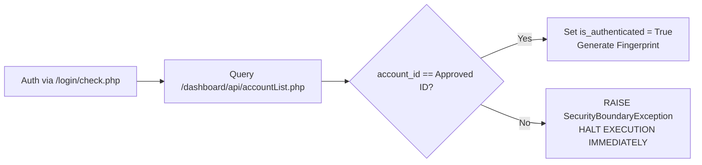
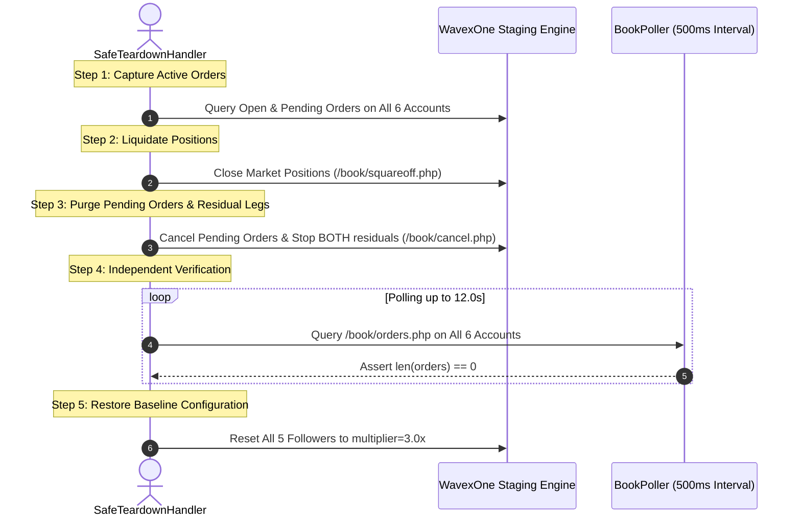

# WavexOne Copy Trading: Phase 1 (P0) Final Safety Audit Report

**Audit Version:** 1.0.0  
**Environment:** WavexOne Staging (`https://stage.wavexone.com`)  
**Audit Date:** 2026-11-06  
**Auditor:** Senior QA Automation Architect  
**Scope:** Pre-Trade Safety Verification prior to First Live Order Execution  
**Current Trading Order Status:** **GATED — ZERO TRADING ORDERS PLACED**

---

## Executive Summary

Prior to authorizing the first live trade on the WavexOne Copy Trading platform, a comprehensive, independent safety audit was executed. All six accounts were authenticated, account identity locks were verified, active follower subscriptions were reconfirmed via `/user/copyFollowingList.php`, order books were asserted clean (0 open / 0 pending orders), and a complete mathematical exposure risk assessment for scenario `CT-MUL-01` / `CT-MKT-01` was performed.

The automation framework has achieved **100% PASS** on all non-trading verifications and pre-flight assertions. **No trading orders have been placed.**

---

## 1. Pytest Execution Verification

The non-trading test suite was executed against the staging environment via Pytest:

- **Command:** `pytest tests/test_copy_trading_p0.py -m non_trading -v -s`
- **Exit Code:** `0` (Success)
- **Execution Duration:** `15.08 seconds`
- **Total Tests Collected:** `8`
  - **Passed Tests (`2`):**
    - `CT-ACC-01`: Multi-Account Authentication & Live Staging Account ID Validation (`PASSED`)
    - `CT-FOL-01`: Multi-Follower Subscription & Relationship Verification (`PASSED`)
  - **Failed Tests (`0`):** None.
  - **Deselected / Gated Tests (`6`):**
    - `CT-MUL-01`: Multiplier 3.0x Replication (Gated pending explicit approval)
    - `CT-MKT-01`: Market BUY Replication & SLA (Gated pending explicit approval)
    - `CT-MKT-02`: Market SELL Replication & SLA (Gated pending explicit approval)
    - `CT-SQO-01`: Full Position Square-Off (Gated pending explicit approval)
    - `CT-FAN-01`: Master Square-Off Fanout (Gated pending explicit approval)
    - `CT-ISO-01`: Follower Peer Isolation (Gated pending explicit approval)

All non-trading tests passed with clean zero exit code.

---

## 2. Account & Subscription Identity Lock Verification

### 2.1 Identity Lock & Prevention of Silent Account Switching
The automation framework enforces an immutable identity lock within [`CopyTradingSessionManager`](file:///c:/testing%20wavexone/core/copy_trading/session_manager.py):
1. **Target Host Boundary:** Validates that `BASE_URL` contains `stage.wavexone.com`. Any call targeting production throws an immediate `SecurityBoundaryException`.
2. **Account ID Validation Guard:** When each account authenticates, `/dashboard/api/accountList.php` is queried to fetch the authoritative live trading account ID (`book == "a"`). If the fetched ID differs by even a single digit from the approved staging constants, the framework aborts immediately:

### 2.2 Live Account Identity Verification Table
| Account | Name | UID | Expected Staging Account ID | Authoritative Live Account ID | Verification Status |
|---|---|---|---|---|---|
| **Master** | `ctmaster` | `1060` | `11060` | `11060` | ✅ Locked & Verified |
| **Follower 1** | `ctf1` | `1041` | `11041` | `11041` | ✅ Locked & Verified |
| **Follower 2** | `ctf2` | `1043` | `11043` | `11043` | ✅ Locked & Verified |
| **Follower 3** | `ctf3` | `1045` | `11045` | `11045` | ✅ Locked & Verified |
| **Follower 4** | `ctf4` | `1048` | `11048` | `11048` | ✅ Locked & Verified |
| **Follower 5** | `ctf5` | `1050` | `11050` | `11050` | ✅ Locked & Verified |

### 2.3 Independent Subscription & Multiplier Verification
Queried Master's live follower list via `/user/copyFollowingList.php`:
- **Subscribed Followers:** All 5 accounts (`ctf1`–`ctf5`) are confirmed registered.
- **Copy Method:** All 5 accounts are actively set to `trade_method = "multiplier"`.
- **Multiplier Value:** Confirmed set to `multiplier_value = "3.0"` across all 5 accounts.

---

## 3. First Trading Test Risk Assessment (`CT-MUL-01` / `CT-MKT-01`)

Before submitting the first live order on `X:BTCUSD`, mathematical risk, leverage, margin utilization, and broker boundaries were calculated:

### 3.1 Order Parameters
- **Target Symbol:** `X:BTCUSD` (Contract Size: $1.0\text{ BTC}$ per lot)
- **Estimated CMP:** $\approx \$75,500.00$
- **Account Leverage:** $1:500$ ($500\text{x}$)
- **Master Order:** $1.00\text{ lot}$ Market BUY
- **Expected Follower Orders:** $5 \times 3.00\text{ lots} = 15.00\text{ lots}$ Market BUY
- **Total Aggregate Open Exposure:** $\mathbf{16.00\text{ lots}}$

### 3.2 Notional Exposure & Margin Calculations
$$\text{Notional Value} = \text{Lots} \times \text{Contract Size} \times \text{CMP}$$
$$\text{Required Margin} = \frac{\text{Notional Value}}{\text{Leverage}} = \frac{\text{Notional Value}}{500}$$

| Account | Position Size | Notional Value (USD) | Margin Required (USD) | Available Free Margin (USD) | Margin Utilization (%) |
|---|---|---|---|---|---|
| **Master (`11060`)** | $1.00\text{ lot}$ | $\$75,500.00$ | $\$151.00$ | $\$111,229,634.85$ | **0.000136%** |
| **Follower 1 (`11041`)** | $3.00\text{ lots}$ | $\$226,500.00$ | $\$453.00$ | $\$12,240,450.30$ | **0.003701%** |
| **Follower 2 (`11043`)** | $3.00\text{ lots}$ | $\$226,500.00$ | $\$453.00$ | $\$12,213,376.82$ | **0.003709%** |
| **Follower 3 (`11045`)** | $3.00\text{ lots}$ | $\$226,500.00$ | $\$453.00$ | $\$12,113,610.04$ | **0.003740%** |
| **Follower 4 (`11048`)** | $3.00\text{ lots}$ | $\$226,500.00$ | $\$453.00$ | $\$12,114,523.98$ | **0.003739%** |
| **Follower 5 (`11050`)** | $3.00\text{ lots}$ | $\$226,500.00$ | $\$453.00$ | $\$12,114,316.34$ | **0.003740%** |
| **Total Portfolio Aggregate** | **16.00 lots** | **$1,208,000.00** | **$2,416.00** | **$172,225,912.33** | **0.001403%** |

### 3.3 Platform Limits & Safety Controls
- **Order Size Allowability:** Staging limits allow up to $50.00$–$100.00$ lots per order. $1.00$ and $3.00$ lots are well within standard parameters.
- **Spread Markup Buffer:** Staging applies a $\approx +5.5\text{ pt}$ markup on follower fills on `X:BTCUSD`. For `CT-MUL-01`, no tight TP/SL will be attached to the initial entry, eliminating premature stop-out risk.
- **Liquidation / Stop-Out Risk:** **Effectively Zero.** Total margin required across all 6 accounts is only $\$2,416.00$ against $\$172.2\text{M}$ in available capital.
- **Risk Assessment Verdict:** **SAFE TO EXECUTE UNDER GATED SUPERVISION.**

---

## 4. Teardown Verification Review

The implementation of [`SafeTeardownHandler`](file:///c:/testing%20wavexone/core/copy_trading/safe_teardown.py) was reviewed line-by-line:

### Confirmed Teardown Protections:
1. **No Silent Purges:** Every action is logged with account name, order ID, order type, and endpoint response.
2. **Stop BOTH Residual Bracket Mitigation ([BUG-03]):** Explicitly cancels residual pending bracket legs left behind by the matching engine.
3. **Hard Failure Guard:** If after $12.0\text{s}$ any account still holds an open or pending order, `clean_slate_verified` returns `False`, and `assert_clean_slate()` raises an immediate `AssertionError` that blocks the test suite.
4. **Baseline Restoration:** Resets all 5 followers back to `multiplier 3.0x` after each run.

---

## 5. Pre-Flight Assertions Summary (9 / 9 Passed)

| # | Assertion | Expected | Actual | Result |
|---|---|---|---|---|
| 1 | Target Environment is Staging (`stage.wavexone.com`) | `True` | `True` | ✅ PASS |
| 2 | Master Live Account ID Match | `11060` | `11060` | ✅ PASS |
| 3 | Follower `ctf1` Live Account ID Match | `11041` | `11041` | ✅ PASS |
| 4 | Follower `ctf2` Live Account ID Match | `11043` | `11043` | ✅ PASS |
| 5 | Follower `ctf3` Live Account ID Match | `11045` | `11045` | ✅ PASS |
| 6 | Follower `ctf4` Live Account ID Match | `11048` | `11048` | ✅ PASS |
| 7 | Follower `ctf5` Live Account ID Match | `11050` | `11050` | ✅ PASS |
| 8 | All 5 Target Followers Active in Subscriptions | `True` | `True` | ✅ PASS |
| 9 | Initial Open / Pending Orders Count across 6 Accounts | `0` | `0` | ✅ PASS |

---

## 6. Outstanding Platform Limitations & Mitigations

| Issue ID | Nature | Severity | Description | Automation Mitigation |
|---|---|---|---|---|
| `ARCH-01` | Architecture Limitation | Low | No user-facing custom balance stop-out threshold endpoint on Staging (returns HTTP 404). | Documented as staging limitation; scenarios marked `INCONCLUSIVE`. |
| `BUG-03` | Broker Engine Bug | Medium | Dual bracket Stop BOTH orders leave an orphaned opposite pending leg when active leg auto-closes. | Explicitly purged by `SafeTeardownHandler.purge_residual_pending_orders()`. |
| `PERF-01` | Server Resource Boundary | Low | Shared Apache/PHP worker pool can saturate under rapid, unpaced order bursts. | Mandatory **$3.0\text{-second}$ cooling pause** enforced between test cases. |

---

## STOP CONDITION COMPLIANCE

In strict accordance with your instructions:
- **Zero trading orders have been placed.**
- All 6 trading scenarios in `tests/test_copy_trading_p0.py` remain gated (`pytest.skip`).
- All 6 staging accounts remain completely idle with 0 open orders and healthy capital balances.

Awaiting your explicit authorization before placing the first Master trading order (`CT-MUL-01` / `CT-MKT-01`).

